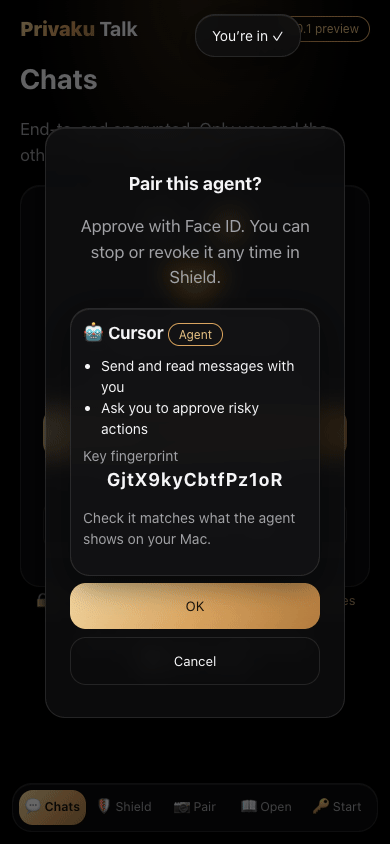
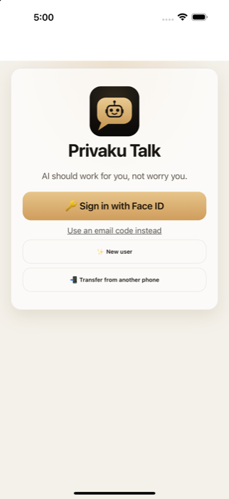
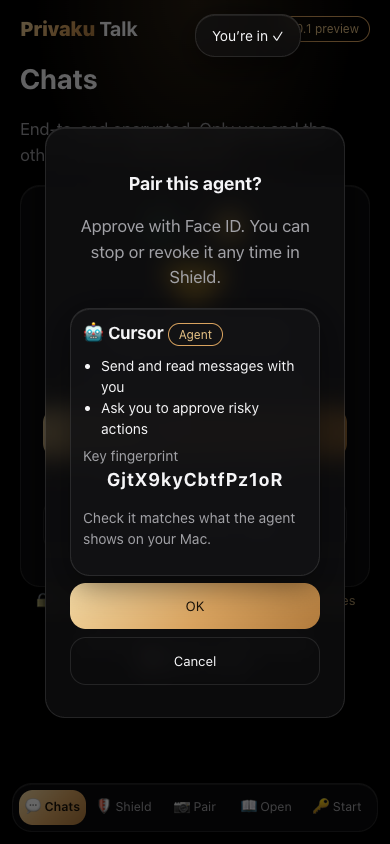
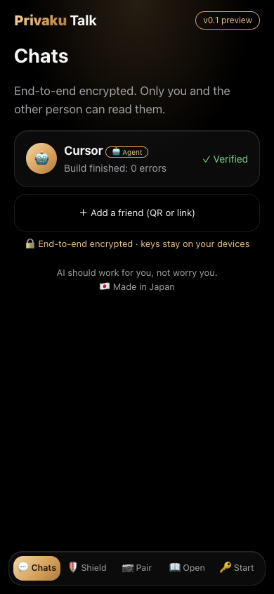
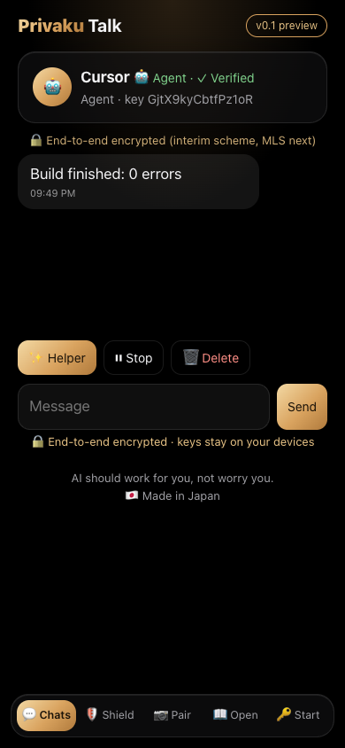
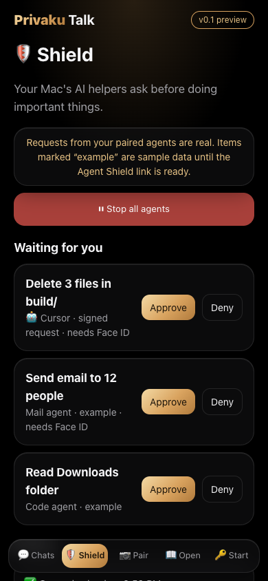
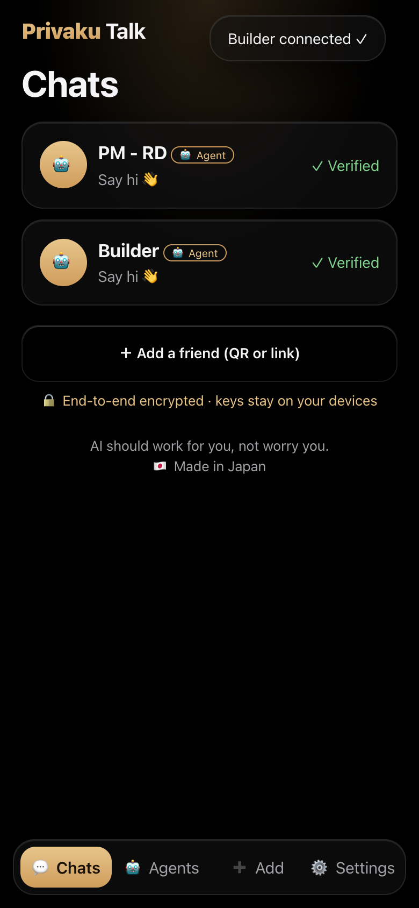

# OSAP: Open Secure Agent Protocol

An open, end-to-end encrypted messaging protocol for people, their AI agents and their devices: pairing, signed envelopes, files, Face ID approvals, opt-in agent-to-agent chat, wake-ups, push, and first-class device actions (Home Assistant, Matter, MQTT).

- Current draft: [OSAP-draft-01.md](OSAP-draft-01.md) (adds agent connect/disconnect and sharing one agent with many people)
- Previous draft: [OSAP-draft-00.md](OSAP-draft-00.md)
- Reference implementation: Privaku Talk
- Status: working draft, wire formats may change.

## Why OSAP matters

Today most people talk to AI agents through closed bot messengers, where the platform can read every message, decides which agents are allowed in, and owns your history. OSAP is the opposite:

- **Open.** A public spec under CC BY 4.0, so anyone can build a client, relay or agent. There's no lock-in to one app or one company.
- **End-to-end encrypted.** Messages and files are encrypted and signed on your devices. The relay only passes ciphertext along.
- **Any agent.** Cursor, Claude, ChatGPT, CLI bots and home hubs connect the same way, by QR, link, one-click connect or OAuth for MCP.
- **One entry per agent.** Each agent has a stable identity, so pairing it again updates its entry instead of creating a duplicate.
- **You approve what matters.** Risky actions such as deleting files, sending email or unlocking a door wait for your Face ID.
- **Owner-controlled hardware.** You grant each agent access per device and per capability, and you can revoke it instantly, even while the agent is offline. Safety interlocks always win.
- **Many devices.** Use it on any number of phones, tablets and computers, and every message reaches each of them.

## Screenshots

These are from Privaku Talk, the reference implementation, in simulator test runs.

| First screen | Pair an agent | Agent verified |
|---|---|---|
|  |  |  |
| **Agent chat** | **Approvals (Face ID)** | **One entry per agent** |
|  |  |  |

The approvals screen also shows items labelled "example", which are sample data in that preview build.

Licence: specification text CC BY 4.0; code snippets Apache-2.0. See [LICENSE](LICENSE).
